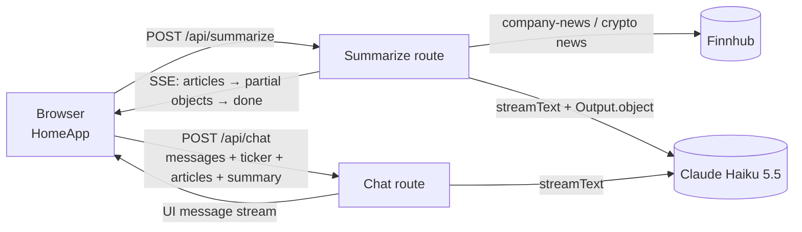

# Fintech Summarizer

AI market briefings for any stock or crypto ticker. Type `NVDA` or `BTC` and get a streaming, structured summary written by Claude — headline, market overview, three key insights and sentiment — plus the five source articles and a chat for follow-up questions grounded in them. English and Spanish.

**Live demo:** [fintech.nicobermudez.com](https://fintech.nicobermudez.com/)

> Educational project. Nothing in the app is investment advice.

## Highlights

- **Streaming structured output** — `streamText` + `Output.object({ schema })` (Vercel AI SDK v6) streams a Zod-typed object over Server-Sent Events; the UI fills in field by field.
- **Relevant news by construction** — Finnhub company news is tagged with the exact symbol; crypto uses Finnhub's crypto feed filtered by coin symbol and name.
- **Grounded, safe chat** — answers only from the loaded articles and summary, never gives buy/sell/hold advice, and treats article text as untrusted data (prompt-injection hardening).
- **Cheap and fast model** — Claude Haiku 5.5 at `effort: "low"`; switchable per environment.
- **Production hardening** — per-IP rate limits, same-origin checks, bounded request schemas, generic errors, security headers, patched dependencies.
- **SEO + GEO** — metadata, Open Graph image, `robots.txt` that welcomes AI crawlers, `sitemap.xml`, `llms.txt`, JSON-LD (`WebApplication` + `FAQPage`), crawlable "How it works" and FAQ.
- **Privacy-first analytics** — Google Analytics 4 loads only when configured **and** the visitor opts in.
- **Editorial design** — a "financial paper" visual system (paper and ink, serif headlines, hairline rules), light and dark, WCAG AA checked with axe.
- **Fully bilingual** — every string in EN/ES (parity tested); API errors are translated codes; a summary can be regenerated after switching language.
- **Tested** — 91 unit/integration tests (≥95% coverage gate, currently ~99.8% lines) and 22 Playwright E2E tests on desktop + mobile, including axe WCAG 2.1 AA. CI on every push.

## Stack

| Layer | Choice |
|---|---|
| Framework | Next.js 16 (App Router, Turbopack), React 19, TypeScript strict |
| Styling | Tailwind CSS v4, shadcn/ui + AI Elements primitives, lucide icons |
| AI | Vercel AI SDK v6 (`ai`, `@ai-sdk/anthropic`, `@ai-sdk/react`), Claude Haiku 5.5 |
| Data | Finnhub (company + crypto news) |
| Validation | Zod 4 |
| Analytics | GA4 via `@next/third-parties`, consent-gated |
| Testing | Vitest + Testing Library (jsdom), Playwright + axe-core |
| Hosting / CI | Vercel, GitHub Actions |

## Architecture at a glance



Full write-up — request flows, modules, prompts, security model, SEO/GEO, testing strategy and design decisions — in **[docs/ARCHITECTURE.md](docs/ARCHITECTURE.md)**.

## Getting started

Requirements: Node 22+, npm.

```bash
npm ci
cp .env.example .env.local   # then fill in the keys below
npm run dev                  # http://localhost:3000
```

### Environment variables

| Variable | Required | Purpose |
|---|---|---|
| `ANTHROPIC_PROD_KEY` | prod | Claude API key used in production (its own spend limit). Takes precedence when set |
| `ANTHROPIC_API_KEY` | dev / preview | Claude API key for local development and previews |
| `FINNHUB_API_KEY` | yes | News data — free key at [finnhub.io](https://finnhub.io) (free plan is for personal use) |
| `ANTHROPIC_MODEL` | no | Override the model (default `claude-haiku-5-5`; e.g. `claude-haiku-4-5-20251001` to roll back) |
| `NEXT_PUBLIC_GA_ID` | no | GA4 measurement ID (`G-…`). Unset = no banner, no analytics. Build-time variable: redeploy after changing it |
| `NEXT_PUBLIC_SITE_URL` | no | Override the canonical URL (default `https://fintech.nicobermudez.com`). Build-time variable |
| `OPENAI_API_KEY` / `OPENAI_MODEL` | no | Only if the hidden GPT provider is re-enabled |

Deployment, Google Analytics setup and the custom-domain checklist: **[docs/DEPLOYMENT.md](docs/DEPLOYMENT.md)**.

## Scripts

| Command | What it does |
|---|---|
| `npm run dev` | Dev server (Turbopack) |
| `npm run build` / `npm start` | Production build / serve it |
| `npm run lint` | ESLint |
| `npm run typecheck` | `tsc --noEmit` |
| `npm test` | Unit + integration tests (Vitest) |
| `npm run test:coverage` | Same, enforcing ≥95% lines/statements/functions/branches |
| `npm run test:e2e` | Playwright (desktop + mobile) against the production build, API mocked. `E2E_BASE_URL=https://… npm run test:e2e` runs it against a deployment |

CI (`.github/workflows/ci.yml`): lint → typecheck → coverage → build → E2E, on pushes to `main` and every PR. No secrets needed.

## Project structure

```
src/
├── app/
│   ├── api/summarize/route.ts   # news + streamed structured summary (SSE)
│   ├── api/chat/route.ts        # grounded chat (AI SDK UI message stream)
│   ├── api/chat/tools.ts        # tool registry (empty; add tools here)
│   ├── layout.tsx               # metadata, Open Graph, viewport
│   ├── page.tsx                 # server component: JSON-LD + <HomeApp/>
│   ├── privacy/page.tsx         # privacy & disclaimer (EN/ES)
│   ├── robots.ts · sitemap.ts · manifest.ts · opengraph-image.tsx
│   └── globals.css              # theme + shadcn/AI Elements tokens
├── components/
│   ├── HomeApp.tsx              # client root: search, SSE state, layout
│   ├── SearchForm.tsx           # ticker input + Popular picker
│   ├── SummarySection.tsx       # AI summary card + chat column
│   ├── Chat.tsx                 # useChat + AI Elements
│   ├── NewsFeed.tsx · NewsCard.tsx · SentimentBadge.tsx
│   ├── InfoSections.tsx         # How it works + FAQ (crawlable copy)
│   ├── Footer.tsx · ConsentBanner.tsx · Analytics.tsx · LanguageToggle.tsx
│   ├── ui/ · ai-elements/       # vendored by the shadcn / AI Elements CLIs
└── lib/
    ├── news.ts                  # Finnhub client, normalization, URL sanitizing
    ├── prompts.ts               # summary + chat prompts
    ├── models.ts                # model choice + effort
    ├── rate-limit.ts            # per-IP limiter, origin check
    ├── sse.ts                   # SSE encode / incremental parse
    ├── types.ts                 # shared types + Zod schemas
    ├── i18n.ts · translations.ts
    ├── consent.ts · analytics.ts
    ├── site.ts · structured-data.ts · tickers.ts · recent-tickers.ts · utils.ts
tests/
├── unit/                        # Vitest: lib, routes, components, full front-end flow
└── e2e/                         # Playwright: user journeys, a11y, SEO files, headers
docs/
├── ARCHITECTURE.md              # how it works and why
├── DEPLOYMENT.md                # Vercel, env vars, GA, domain, operations
└── AUDIT.md                     # technical audit (Spanish) and open items
```

## Adding a chat tool

Register it in `src/app/api/chat/tools.ts`; the route picks up everything in `chatTools`:

```ts
import { tool, type ToolSet } from "ai";
import { z } from "zod";

export const chatTools = {
  analyzeTicker: tool({
    description: "Pull news + summary for a different ticker.",
    inputSchema: z.object({ ticker: z.string() }),
    execute: async ({ ticker }) => { /* ... */ },
  }),
} satisfies ToolSet;
```

Render its output in `src/components/Chat.tsx` by handling the `tool-<name>` part type.

## Notes

- This is Next.js 16: read `node_modules/next/dist/docs/` before changing framework code (see `AGENTS.md`).
- npm is the package manager (`package-lock.json` only).
- Rate limiting is in-memory per serverless instance; for a global limit back `src/lib/rate-limit.ts` with Upstash Redis / Vercel KV.
- `src/components/ui` and `src/components/ai-elements` are CLI-generated and excluded from lint and coverage.
