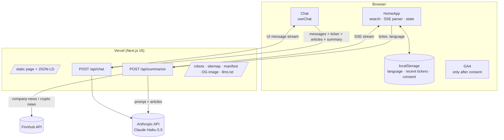
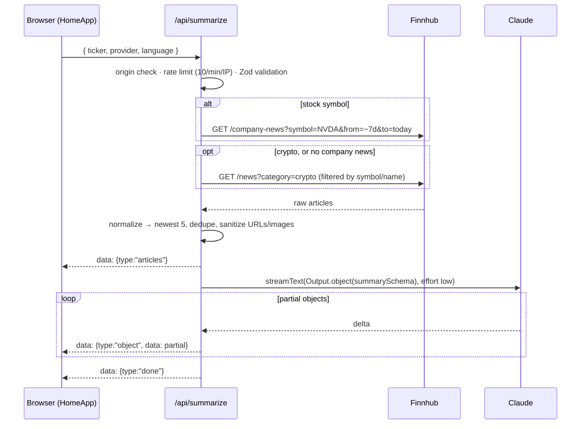

# Architecture

How Fintech Summarizer works, and why it is built this way. Last updated 2026-11-17.

## 1. Overview

A single-page Next.js 16 app with two API routes. There is no database and no user account: every analysis is computed on demand from live news, and the only state that persists lives in the visitor's browser (language, recent tickers, cookie choice).

## 2. Request flows

### 2.1 Analyze a ticker — `POST /api/summarize`

- **Wire format.** Plain SSE (`text/event-stream`) with four message types: `articles`, `object` (each partial object), `error`, `done`. Articles go first so the page has content while the model is still writing.
- **Client.** `HomeApp` reads the body with a `ReadableStream` reader and feeds text to `createSseParser()` (`lib/sse.ts`), which keeps partial frames buffered and skips malformed ones. A new search aborts the previous one; unmounting the page aborts too.
- **Errors.** Validation → 400, cross-origin → 403, rate limit → 429 with `Retry-After`, missing key → 503, news failure → 502. Model failures arrive in-stream as a generic `error` chunk. Detailed errors go to server logs only.

### 2.2 Follow-up chat — `POST /api/chat`

- The client (`useChat` from `@ai-sdk/react`) sends the conversation **plus the current ticker, articles and partial summary** with every turn. The server is stateless, so it rebuilds the grounded system prompt each time.
- Because that context comes from the browser, `chatRequestSchema` bounds everything: ≤ 20 messages, each ≤ 2,000 characters of text, roles `user`/`assistant` only, ≤ 5 articles, capped field lengths.
- Response: `toUIMessageStreamResponse()`; model errors are replaced with a generic message.
- `tools.ts` is an empty `ToolSet`, wired with `stopWhen: stepCountIs(5)`, ready for tools.

## 3. Modules

| Module | Responsibility |
|---|---|
| `lib/news.ts` | Finnhub client. Stocks use `/company-news` (last 7 days); Finnhub tags it loosely, so articles are kept only if the headline/summary names the company (symbol case-sensitive; names and aliases from `tickers.ts`, or Finnhub's `/stock/profile2` name for other tickers), falling back to the unfiltered feed when fewer than 2 match; coins use `/news?category=crypto` filtered by whole-word symbol/name; a symbol with no company news falls back to crypto. Normalizes to `NewsArticle`, keeps the newest 5, dedupes by URL, decodes HTML entities, allows only `http(s)` links and `https` images. Token in the `X-Finnhub-Token` header. |
| `lib/prompts.ts` | Summary prompt and chat system prompt (§4). |
| `lib/models.ts` | API key (`ANTHROPIC_PROD_KEY` in production, else `ANTHROPIC_API_KEY`), model choice (`ANTHROPIC_MODEL`, default `claude-haiku-5-5`) and `providerOptions` (`effort: "low"`, only for Claude 5.x models, which accept it). |
| `lib/rate-limit.ts` | Fixed-window per-IP limiter, `clientKey` (from `x-forwarded-for`), `isAllowedOrigin`, 429 helper. |
| `lib/sse.ts` | `encodeSse` (server) and `createSseParser` (client). |
| `lib/types.ts` | Shared types and Zod schemas: request validation and the summary output schema. |
| `lib/i18n.ts` / `translations.ts` | `LanguageProvider` (persists choice, syncs `<html lang>`) and the EN/ES dictionary. The dictionary is a plain module so server code (JSON-LD) can read it too. |
| `lib/consent.ts` / `analytics.ts` | Consent store on `useSyncExternalStore` (syncs across tabs) and `trackEvent`, a no-op until GA has loaded. |
| `lib/site.ts` / `structured-data.ts` | Site identity (URL, name, author) and the JSON-LD graph. |
| `components/HomeApp.tsx` | Client root: search state, SSE consumption, layout (summary + chat first, sources below), footer, consent banner, GA. |

## 4. Model and prompts

- **Model:** Claude Haiku 5.5 ($0.10 / $0.50 per million input/output tokens for prompts ≤ 100K), roughly 10× cheaper than Haiku 4.5. It thinks adaptively by default; summaries and chat replies are short, so requests use `effort: "low"`. Thinking counts toward `maxOutputTokens`, so the caps leave headroom (summary 2,000, chat 1,500); the prompts keep the visible output short.
- **Summary prompt:** analyst role, today's date, "use only these articles", ignore results that are not about the ticker and say so if fewer than two are, exactly three insights, sentiment describes the tone of the coverage (not a forecast), no buy/sell/hold advice. Output is enforced by the Zod schema (`headline`, `marketOverview`, `keyInsights[3]`, `sentiment`).
- **Chat prompt:** educational assistant (explicitly *not* a licensed advisor), no buy/sell/hold, price targets or position sizing; declines off-topic requests; grounds specific claims only in the context; short answers.
- **Prompt-injection defense:** article text is third-party data. It is wrapped in `<articles>` / `<article>` tags, its `<` and `>` are replaced with look-alike characters so it cannot close those tags, and both prompts say content inside them is data, never instructions.

## 5. Security model

| Threat | Mitigation |
|---|---|
| Cost abuse of the AI endpoints | Per-IP limits (summary 10/min, chat 20/min); same-origin check for browser calls; bounded payloads; capped output tokens. **Plus** a monthly spend limit in the Anthropic console (operational, see DEPLOYMENT.md). |
| Limits are per serverless instance | Accepted for a demo. For a global limit, back the same interface with Upstash Redis / Vercel KV. |
| Malicious links/images from feeds | Only `http(s)` links and `https` images survive normalization; cards open with `rel="noopener noreferrer"`; images load with `referrerpolicy="no-referrer"`. |
| Prompt injection via articles or chat context | Delimited, escaped untrusted data; schema bounds; the model has no tools that act. |
| Leaking internals | Generic client errors; API keys only in headers and server env; no `x-powered-by`. |
| XSS via JSON-LD | `<` escaped to `<` in the serialized JSON-LD. |
| Clickjacking / sniffing | `X-Frame-Options: DENY`, `X-Content-Type-Options: nosniff`, `Referrer-Policy`, `Permissions-Policy`. A nonce-based CSP is deliberately deferred (it forces dynamic rendering); see `next.config.ts`. |
| Vulnerable dependencies | Next 16.4.6; `npm audit` shows only low-severity transitive issues. |

## 6. SEO and GEO

The page is statically prerendered, so crawlers get real HTML.

- `layout.tsx`: title template, description, canonical, Open Graph + Twitter cards, theme color. `opengraph-image.tsx` renders a 1200×630 PNG.
- `robots.ts`: allows everything except `/api/`, and lists AI crawlers explicitly (GPTBot, OAI-SearchBot, ClaudeBot, PerplexityBot, Google-Extended, …) to signal that the site wants to be cited.
- `sitemap.ts`, `manifest.ts`, `public/llms.txt` (a plain-text summary for LLM crawlers).
- JSON-LD `WebApplication` + `FAQPage` in `page.tsx`, built from the same FAQ copy that is visible on the page.
- "How it works" and FAQ sections give answer engines citable text.

## 7. Analytics and consent

- GA4 loads (`@next/third-parties` `GoogleAnalytics`) only if `NEXT_PUBLIC_GA_ID` is a valid `G-…` ID **and** consent is `granted`. Without the ID, there is no banner and no script.
- Consent is stored in localStorage and can be reset from "Cookie settings" in the footer.
- Events: `analyze_ticker` (ticker, language), `analyze_error` (HTTP status), `chat_message` (grounded, language). No chat text or personal data is sent.

## 8. Front-end

- Layout: hero + search → (after the first search) AI summary and chat side by side on desktop (`lg`), stacked on mobile → source articles → How it works + FAQ → footer. Result panels stay hidden until the first search.
- News grid: 1/2/3 columns; when there are 2 or 5 articles the first card spans two columns so the grid has no holes; cards without an image get a placeholder when others have one, so heights line up.
- The summary card sets the row height on desktop and the chat fills it, scrolling internally.
- Theme: dark only. `globals.css` defines the shadcn/AI Elements tokens (`--primary`, `--secondary`, `--muted-foreground`, …) that the vendored components rely on.
- Accessibility: axe WCAG 2.1 AA runs in E2E; touch targets ≥ 44px on mobile; `motion-reduce` respected on the main button; `<html lang>` follows the language toggle.

## 9. Testing strategy

| Layer | Tool | What it covers |
|---|---|---|
| Unit | Vitest (node) | news normalization and Finnhub routing, prompts, rate limiter, SSE, model options, analytics, consent |
| Integration | Vitest + `ai/test` `MockLanguageModelV3` | both API routes end to end with a fake model: streaming, validation, limits, error masking |
| Component / flow | Vitest + Testing Library (jsdom) | the whole front-end pipeline with a mocked `fetch` streaming SSE: search → news → summary → history → errors → abort → i18n; chat; consent/GA; SEO metadata |
| E2E | Playwright, desktop + Pixel 7 | real production build in Chromium with `/api/*` mocked: user journey incl. chat, errors, i18n persistence, axe WCAG 2.1 AA, robots/sitemap/OG/llms.txt, security headers, API guards, 404 |

Coverage thresholds are 95% for lines, statements, functions and branches (vendored `ui/` and `ai-elements/` excluded). No test calls Anthropic or Finnhub; set `E2E_BASE_URL` to smoke-test a real deployment.

## 10. Design decisions

| Decision | Why | Trade-off |
|---|---|---|
| Custom SSE for the summary instead of the AI SDK data stream | Articles must reach the UI before the model starts; a four-type protocol is easy to test | Own parser to maintain (small, fully tested) |
| Client sends grounding context to `/api/chat` | Stateless server, no storage | Context is user-controlled → strict bounds, prompt defenses |
| Finnhub instead of NewsAPI | NewsAPI's free plan forbids any production use; Finnhub's company news is real-time and symbol-tagged (loosely, hence the name filter) | Free plan is personal-use only; crypto has no per-coin endpoint (filtered feed instead); company news covers North American listings |
| Claude Haiku 5.5 at low effort | Cheapest current model; summaries are short and well-structured | Adaptive thinking adds some latency vs. Haiku 4.5 |
| In-memory rate limiting | Zero infrastructure | Per-instance, not global |
| No nonce CSP yet | Keeps the page static (fast, cacheable) | Weaker XSS defense-in-depth |
| GA behind explicit consent | GDPR / Chilean Law 21.719 friendly by default | Fewer measured sessions |
